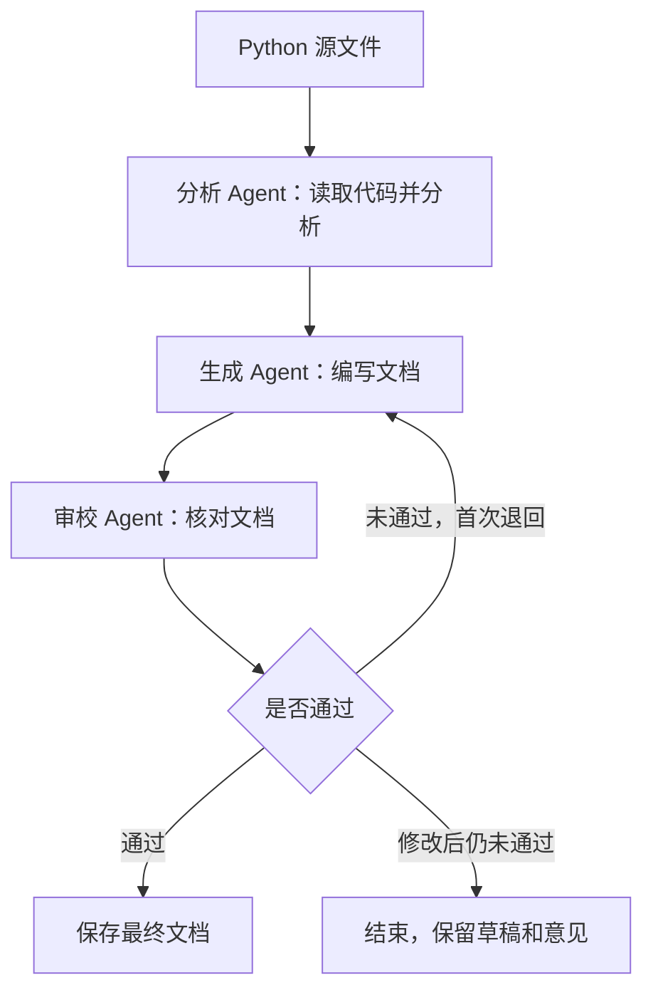

# 代码文档生成 Workflow

软件工程与项目实践第二次作业。在第一次 CodeAgent 的基础上，复用文件读取工具和模型调用循环，增加分析、文档生成、审校三个 Agent。

输入一个 Python 文件，依次完成代码分析、编写使用文档和审校。审校未通过时，根据意见修改一次，再次检查。

## 运行

推荐使用 Python 3.10 或以上版本。

无需 API Key 的示例：

```bash
python3 main.py --demo
```

演示一次审校退回和修改：

```bash
python3 main.py --demo-revision
```

离线模式使用预设回复，只支持随附的 `examples/sample_code.py`，用于演示文件读取、节点间传参和流程控制。

使用模型服务分析其他文件：

```bash
python3 -m venv .venv
source .venv/bin/activate
python -m pip install -r requirements.txt
cp .env.example .env
```

在 `.env` 中填写自己的 API Key。默认使用通义千问兼容接口，也可以修改 `OPENAI_BASE_URL` 和 `MODEL_NAME`，使用其他支持工具调用的兼容服务。

```bash
python main.py examples/sample_code.py
python main.py /path/to/your_module.py --output outputs/custom
```

## 工作流程



三个 Agent 使用各自的提示词和消息上下文，由编排器依次调用。分析结果、文档草稿和审校意见保存在 `WorkflowState` 中，作为下一节点的输入。

## 运行结果

默认保存在 `outputs/latest/`，可用 `--output` 修改目录。再次使用同一目录运行时，会覆盖上一轮结果。

| 文件 | 内容 |
| --- | --- |
| `generated_document.md` | 审校通过的最终文档 |
| `analysis.json` | 代码分析结果 |
| `draft.md` | 最近一次草稿 |
| `review.json` | 审校结果和修改意见 |
| `state.json` | 流程状态及各节点结果 |
| `events.jsonl` | 节点执行日志 |

## 文件说明

- `main.py`：命令行入口。
- `agent.py`：模型请求和工具调用循环。
- `tools.py`：读取文件、列出目录，复用第一次作业。
- `workflow.py`：三个 Agent 的定义、共享状态和执行顺序。
- `demo.py`：离线示例的预设回复。
- `examples/sample_code.py`：示例输入。
- `tests/test_workflow.py`：流程和接口测试。
- [Design.md](Design.md)：设计说明。

## 测试与打包

安装依赖后执行：

```bash
python -m unittest discover -s tests -v
python package.py
```

测试覆盖顺序执行、审校返工、失败退出和调用次数限制。接口测试通过 OpenAI SDK 请求本地模拟服务；远端模型调用尚未验证。

打包文件为 `2403080546王超浩.zip`，包含源码、README、设计文档和测试，不包含密钥、虚拟环境及运行日志。
